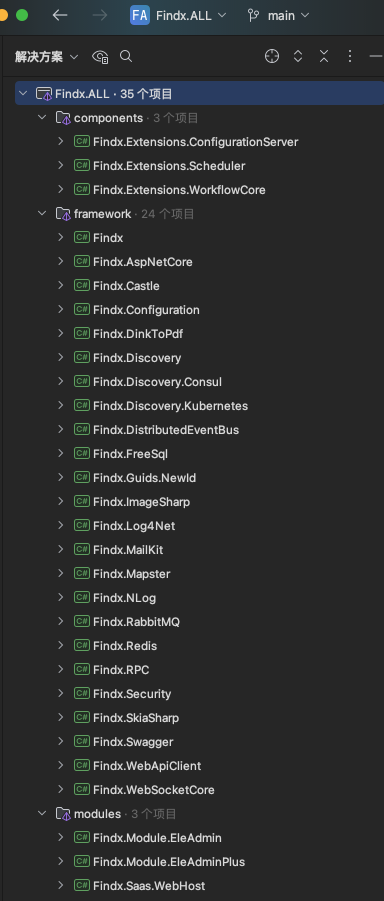

<h2 align="center"> Findx 快速开发框架</h2>

<div align="center" style="text-align:center">

[](https://github.com/q315523275/Findx/blob/main/LICENSE)
[](https://github.com/q315523275/Findx/stargazers)
[](https://github.com/q315523275/Findx/network)

</div>

## 🍟 概述

基于 .NET6/.NET8/.NET9 实现的通用快速开发框架，整合众多优秀技术和框架，模块化方式开发。集成多租户、缓存、数据校验、鉴权、事件总线、通讯、远程请求、任务调度等众多黑科技。代码结构简单清晰，注释详尽，易于上手与二次开发，即便是复杂业务逻辑也能迅速实现，真正实现“开箱即用”。

```
如果对您有帮助，您可以点右上角 “Star” 收藏一下 ，谢谢！~
```

## 🍖 框架组件组织



-   Findx：框架的核心组件，框架各个组件的核心接口定义，部分核心功能的实现，包含Aspect、缓存、原子计数、哈希一致性、Cron、实体约定、分表分库、审计、Id生成器(有序Guid/雪花Id)、工作单元、仓储、软删除、租户、各域字典、自动注入、邮件、领域事件、进程事件总线、异常处理器、基础扩展、图像处理(包含验证码)、调度任务(默认内存版)、拉姆达表达式扩展(Json转表达式)、锁(包含续期锁)、机器信息(Cpu、内存、磁盘、流量等)、对象映射、CQRS、模块化、HtmlToPdf、池(StringBuilder、MemoryStream)、进程命令执行器、Redis接口、反射类查询器、认证授权、序列化、配置聚合、短信、存储、线程相关、工具集(压缩、Cron、Csv、脱敏、目录、文件、加密、随机、验证等等)、启动应用端口验证等等。
-   Findx.AspNetCore：AspNetCore 组件，提供 AspNetCore 的服务端功能的封装，包含各个模块化构建、HttpClient各策略创建、各个策略过滤器(防重、审计、异常、验证、租户、内网访问、限速、事物等)、全局异常处理、Crud、端点资源处理、Razor视图读取器、Cors配置、静态ServiceScopeResolver实现等等
-   Findx.Castle：Castle 组件，提供异步Aop功能。
-   Findx.Configuration：Configuration 组件，实现配置中心客户端，采用Http长轮询方式实现配置的热更新，实现IConfiguration读取配置零侵入。
-   Findx.Extensions.ConfigurationServer：Configuration 组件，实现配置中心服务端，采用Http长轮询方式实现配置变更通知，模块化方式Nuget引用后直接使用。
-   Findx.DinkToPdf：Pdf 组件，实现Html生成Pdf功能，内嵌libwkhtmltox.so文件Linux部署无法额外安装其他组建。
-   Findx.Discovery：服务发现 组件，包含服务的发现与注册，内置负载算法（IP哈希一致性、最小连接数、随机、轮询），实现HttpClient的HttpMessageHandler负载端点计算减少代码侵入，默认实现配置文件方式的服务发现功能。
-   Findx.Discovery.Consul：Consul 组件，以Consul实现服务发现与注册功能。
-   Findx.FreeSql：FreeSql 组件，实现Findx统一的仓储定义功能，扩展实现逻辑删除、多租户、多FreeSql实例、实体标注自动实现切库切表、工作单元、工作单元管理、工作单元事件、Sql打印、慢Sql事件触发、分页总数是否查询、表集合及表字段查询、主健值自动创建等。
-   Findx.Guids.NewId：NewId 组件，实现有序Guid的生成。
-   Findx.ImageSharp：ImageSharp 组件，实现二维码生成，实现图片的处理功能，包括尺寸、裁剪、压缩、灰度化、二值化、旋转、翻转、图片合并、绘制文本、图片水印、文字水印等等图片处理功能。
-   Findx.Log4Net：Log4Net 组件，用Log4Net实现日志的输出与记录，内置配置文件。
-   Findx.NLog：NLog 组件，用NLog实现日志的输出与记录，内置配置文件。
-   Findx.MailKit：MailKit 组件，使用 MailKit 实现邮件的发送功能。
-   Findx.Mapster：Mapster 组件，实现对象的映射功能，高性能。
-   Findx.RabbitMQ：RabbitMQ 队列组件，实现属性标记(队列特性)的队列消息消费方式，实现异常处理回调，自定义消息序列化器。
-   Findx.Redis：StackExchange.Redis 组件，实现公共缓存组件，实现IRedisClient 统一操作功能，实现分布式锁功能，支持多实例操作、支持独立序序列化配置。
-   Findx.Security：认证授权 组件，支持Jwt、Cookie认证，授权支持角色、资源标记、角色及资源同时验证，可以实现IFunctionStore接口来实现端点资源的在线管理。
-   Findx.Swagger：Swagger 组件，使用 Swagger 生成 应用的在线接口文档信息。
-   Findx.WebApiClient：WebApiClient 组件，声明式 远端接口请求，并扩展增加服务发现、熔断、降级、超时等功能，实现配置设置优先策略。
-   Findx.WebSocketCore：WebSocket 组件，实现自定义 WebSocket 功能，其中包括 WebSocket 客户端与服务端、客户端连接管理等等功能。
-   Findx.Module.EleAdminPlus：EleAdminPlus 组件，收费前端 EleAdminPlus 的C#实现，通用权限管理平台 模块。

-   Findx.WebHost：部分功能 的 使用示例。
-   WebApplication1：配置中心 客户端 使用示例。


## 🎁 Nuget Packages

| 包名称                                                                                                          |版本|下载数|
|--------------------------------------------------------------------------------------------------------------|----|----|
| [Findx](https://www.nuget.org/packages/Findx/)                                                               |[](https://www.nuget.org/packages/Findx/)|[](https://www.nuget.org/packages/Findx/)|
| [Findx.AspNetCore](https://www.nuget.org/packages/Findx.AspNetCore/)                                         |[](https://www.nuget.org/packages/Findx.AspNetCore/)|[](https://www.nuget.org/packages/Findx.AspNetCore/)|
| [Findx.RabbitMQ](https://www.nuget.org/packages/Findx.RabbitMQ/)                                             |[](https://www.nuget.org/packages/Findx.RabbitMQ/)|[](https://www.nuget.org/packages/Findx.RabbitMQ/)|
| [Findx.ImageSharp](https://www.nuget.org/packages/Findx.ImageSharp/)                                         |[](https://www.nuget.org/packages/Findx.ImageSharp/)|[](https://www.nuget.org/packages/Findx.ImageSharp/)|
| [Findx.FreeSql](https://www.nuget.org/packages/Findx.FreeSql/)                                               |[](https://www.nuget.org/packages/Findx.FreeSql/)|[](https://www.nuget.org/packages/Findx.FreeSql/)|
| [Findx.Swagger](https://www.nuget.org/packages/Findx.Swagger/)                                               |[](https://www.nuget.org/packages/Findx.Swagger/)|[](https://www.nuget.org/packages/Findx.Swagger/)|
| [Findx.Redis](https://www.nuget.org/packages/Findx.Redis/)                                                   |[](https://www.nuget.org/packages/Findx.Redis/)|[](https://www.nuget.org/packages/Findx.Redis/)|
| [Findx.Discovery](https://www.nuget.org/packages/Findx.Discovery/)                                           |[](https://www.nuget.org/packages/Findx.Discovery/)|[](https://www.nuget.org/packages/Findx.Discovery/)|
| [Findx.Security](https://www.nuget.org/packages/Findx.Security/)                                             |[](https://www.nuget.org/packages/Findx.Security/)|[](https://www.nuget.org/packages/Findx.Security/)|
| [Findx.WebApiClient](https://www.nuget.org/packages/Findx.WebApiClient/)                                     |[](https://www.nuget.org/packages/Findx.WebApiClient/)|[](https://www.nuget.org/packages/Findx.WebApiClient/)|
| [Findx.Mapster](https://www.nuget.org/packages/Findx.Mapster/)                                               |[](https://www.nuget.org/packages/Findx.Mapster/)|[](https://www.nuget.org/packages/Findx.Mapster/)|
| [Findx.Configuration](https://www.nuget.org/packages/Findx.Configuration/)                                   |[](https://www.nuget.org/packages/Findx.Configuration/)|[](https://www.nuget.org/packages/Findx.Configuration/)|
| [Findx.NLog](https://www.nuget.org/packages/Findx.NLog/)                                                     |[](https://www.nuget.org/packages/Findx.NLog/)|[](https://www.nuget.org/packages/Findx.NLog/)|
| [Findx.DinkToPdf](https://www.nuget.org/packages/Findx.DinkToPdf/)                                           |[](https://www.nuget.org/packages/Findx.DinkToPdf/)|[](https://www.nuget.org/packages/Findx.DinkToPdf/)|
| [Findx.WebSocketCore](https://www.nuget.org/packages/Findx.WebSocketCore/)                                   |[](https://www.nuget.org/packages/Findx.WebSocketCore/)|[](https://www.nuget.org/packages/Findx.WebSocketCore/)|
| [Findx.Discovery.Consul](https://www.nuget.org/packages/Findx.Discovery.Consul/)                             |[](https://www.nuget.org/packages/Findx.Discovery.Consul/)|[](https://www.nuget.org/packages/Findx.Discovery.Consul/)|
| [Findx.MailKit](https://www.nuget.org/packages/Findx.MailKit/)                                               |[](https://www.nuget.org/packages/Findx.MailKit/)|[](https://www.nuget.org/packages/Findx.MailKit/)|
| [Findx.Castle](https://www.nuget.org/packages/Findx.Castle/)                                                 |[](https://www.nuget.org/packages/Findx.Castle/)|[](https://www.nuget.org/packages/Findx.Castle/)|
| [Findx.Guids.NewId](https://www.nuget.org/packages/Findx.Guids.NewId/)                                       |[](https://www.nuget.org/packages/Findx.Guids.NewId/)|[](https://www.nuget.org/packages/Findx.Guids.NewId/)|
| [Findx.Extensions.ConfigurationServer](https://www.nuget.org/packages/Findx.Extensions.ConfigurationServer/) |[](https://www.nuget.org/packages/Findx.Extensions.ConfigurationServer/)|[](https://www.nuget.org/packages/Findx.Extensions.ConfigurationServer/)|
| [Findx.Module.EleAdminPlus.WebAppApi](https://www.nuget.org/packages/Findx.Module.EleAdminPlus.WebAppApi/)             |[](https://www.nuget.org/packages/Findx.Module.EleAdminPlus.WebAppApi/)|[](https://www.nuget.org/packages/Findx.Module.EleAdminPlus.WebAppApi/)|


## 🍁 说明

-   Findx.Module.EleAdminPlus Swagger 在线地址：http://106.54.160.19:10020/swagger/index.html
-   EleAdminPlus Vue通用管理后端 在线地址：http://106.54.160.19:8080/  admin 123456

## 📚 文档索引

| 主题 | 文档 |
|---|---|
| 框架核心（通用扩展、实体约定、仓储、事件总线、锁、池、工具集等） | [docs/Findx.md](docs/Findx.md) |
| 模块化与自动注入 | [docs/Module.md](docs/Module.md) |
| Aspect 切面与审计 | [docs/Aspect.md](docs/Aspect.md) / [docs/Auditing.md](docs/Auditing.md) |
| 缓存（本地 / Redis） | [docs/Cache.md](docs/Cache.md) |
| 一致性哈希 | [docs/ConsistentHash.md](docs/ConsistentHash.md) |
| 认证授权（JWT / Cookie / 功能权限） | [docs/Findx.Security.md](docs/Findx.Security.md) |
| AspNetCore（过滤器、中间件、客户端 IP 解析、Crud） | [docs/Findx.AspNetCore.md](docs/Findx.AspNetCore.md) |
| FreeSql（数据源、审计脱敏、事务、慢 SQL） | [docs/Findx.FreeSql.md](docs/Findx.FreeSql.md) |
| Redis（客户端、集合枚举语义、分布式锁） | [docs/Findx.Redis.md](docs/Findx.Redis.md) |
| WebSocketCore（服务端、会话、响应消息读取） | [docs/Findx.WebSocketCore.md](docs/Findx.WebSocketCore.md) |
| 服务发现与负载均衡 | [docs/Findx.Discovery.md](docs/Findx.Discovery.md) / [docs/Findx.Discovery.Consul.md](docs/Findx.Discovery.Consul.md) |
| 定时任务 / Cron | [docs/Cron.md](docs/Cron.md) |
| 配置中心 | [docs/Findx.Configuration.md](docs/Findx.Configuration.md) |
| 其余组件（NLog / MailKit / Mapster / Swagger / 图像 / IP / 规则引擎 / RabbitMQ 等） | 见 `docs/` 目录同名文件 |

## 📙 启动

```
var builder = WebApplication.CreateBuilder(args);

// Add services to the container.
builder.Services.AddFindx().AddModules();
builder.Services.AddControllers()
    .AddMvcFilter<FindxGlobalAttribute>()
    .AddJsonOptions(options =>
    {
        options.JsonSerializerOptions.DictionaryKeyPolicy = JsonNamingPolicy.CamelCase;
        options.JsonSerializerOptions.Encoder = JavaScriptEncoder.UnsafeRelaxedJsonEscaping;
        options.JsonSerializerOptions.DefaultIgnoreCondition = JsonIgnoreCondition.WhenWritingNull;
        options.JsonSerializerOptions.Converters.Add(new DateTimeJsonConverter());
        options.JsonSerializerOptions.Converters.Add(new DateTimeNullableJsonConverter());
        options.JsonSerializerOptions.Converters.Add(new LongStringJsonConverter());
    });
builder.Services.AddWebSockets(x => { x.KeepAliveInterval = TimeSpan.FromMinutes(2); });
builder.Services.AddCorsAccessor();

var app = builder.Build();

// Configure the HTTP request pipeline.
app.UseJsonExceptionHandler();
app.UseCorsAccessor().UseRouting();
app.UseStaticFiles(new StaticFileOptions
{
    RequestPath = "/storage",
    FileProvider = new PhysicalFileProvider(Path.Combine(Environment.CurrentDirectory, "storage"))
});
app.UseWebSockets().MapWebSocketManager("/ws", app.Services.GetRequiredService<WebSocketHandler>());
app.UseFindx();
app.MapControllersWithAreaRoute();
// app.UseWelcomePage();

// Run Server
app.UseFindxHosting();
```

## 💐 特别鸣谢


