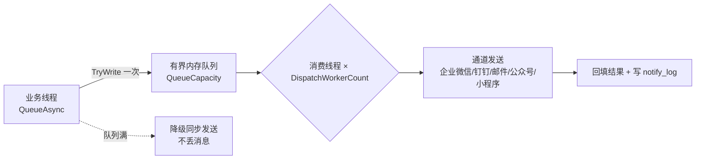

# Findx.Extensions.Notify

统一消息通知组件：一个 `INotifySender` 出口，把同一份内容发给企业微信、钉钉、邮件、微信公众号、微信小程序。通道按配置启用，未启用的通道不会被注册，调用时返回可读原因而不是静默丢弃。

**业务线程默认零 IO**：`QueueAsync` 只构造消息并入内存队列（`TryWrite` 一次），实际发送与日志落库都在后台消费线程完成。只有需要立即知道成败时才用 `SendAsync`。

> Nuget 包引用

```
Findx.Extensions.Notify
```

目标框架：`net6.0` / `net8.0` / `net10.0`。依赖 `Findx`（模块体系 + `IEmailSender`）、`Findx.FreeSql`（日志表实体）、`Microsoft.Extensions.Http`（`IHttpClientFactory`）。

> 装配

```csharp
builder.Services.AddFindx().AddModules();   // 自动发现 NotifyModule
```

`NotifyModule` 等级 `Application`、顺序 `130`，会注册 `INotifySender`、已启用的通道、异步队列（`BackgroundService`）与日志存储。

## 同步还是异步

| 方式 | 方法 | 调用线程开销 | 返回 | 适用 |
|---|---|---|---|---|
| 异步投递（推荐） | `QueueAsync(message)` | 对象构造 + 一次队列 `TryWrite`，**无网络、无数据库** | 日志编号 `long`（0 表示消息为空） | 业务主流程中的通知 |
| 同步发送 | `SendAsync(message)` | 一次 HTTP/SMTP 往返（最长 `TimeoutSeconds`）+ 一次日志写库 | `NotifyResult` | 必须立刻知道成败、需要严格顺序 |

异步路径的完整链路：



队列满（`QueueCapacity` 打满）时 `QueueAsync` 不会丢消息，而是降级为同步发送并打一条告警日志——这是唯一的"会占用业务线程"的异常路径。

## Json 配置

```json
{
  "Findx": {
    "Notify": {
      "Enabled": true,
      "TimeoutSeconds": 10,
      "LogEnabled": true,
      "NodeName": "app-node-1",
      "QueueCapacity": 2048,
      "DispatchWorkerCount": 2,
      "WeCom": {
        "Enabled": true,
        "WebhookUrl": "https://qyapi.weixin.qq.com/cgi-bin/webhook/send?key=xxxxxxxx"
      },
      "DingTalk": {
        "Enabled": true,
        "WebhookUrl": "https://oapi.dingtalk.com/robot/send?access_token=xxxxxxxx",
        "Secret": "SECxxxxxxxx"
      },
      "Email": {
        "Enabled": true,
        "IsBodyHtml": true
      },
      "WeChat": {
        "Enabled": true,
        "AppId": "wx1234567890",
        "AppSecret": "xxxxxxxx",
        "TemplateId": "模板编号"
      },
      "WeChatMiniProgram": {
        "Enabled": true,
        "AppId": "wxabcdef123456",
        "AppSecret": "xxxxxxxx",
        "TemplateId": "订阅模板编号",
        "Page": "pages/index/index",
        "MiniProgramState": "formal",
        "Lang": "zh_CN",
        "TruncateTooLongValue": true
      }
    },
    "Email": {
      "Host": "smtp.example.com",
      "Port": 465,
      "UserName": "notify@example.com",
      "Password": "授权码",
      "EnableSsl": true,
      "FromAddress": "notify@example.com",
      "FromDisplayName": "系统通知"
    }
  }
}
```

> `Findx:Notify` 通用项

| 配置项 | 默认值 | 说明 |
|---|---|---|
| `Enabled` | `true` | 组件总开关，关掉后所有发送直接返回失败 |
| `TimeoutSeconds` | `10` | 单次发送超时上限，超时收敛成 `NotifyResult.Success=false` |
| `LogEnabled` | `true` | 是否写 `notify_log`。关掉后不落表（发送行为不变） |
| `NodeName` | 空 | 写入日志，多实例部署时定位是哪个节点发出的 |
| `QueueCapacity` | `2048` | 异步队列容量，满时降级同步发送 |
| `DispatchWorkerCount` | `2` | 后台发送线程数 |
| `WeCom.Enabled` / `DingTalk.Enabled` / `Email.Enabled` / `WeChat.Enabled` / `WeChatMiniProgram.Enabled` | `false` | 通道开关，必须显式打开 |

通道 `Enabled` 默认 `false`：没显式开启就不注册，调用时返回「通道 xx 未启用」，不会出现"配了参数但开关没开、消息静默丢掉"。

> 企业微信 `Findx:Notify:WeCom`

| 配置项 | 说明 |
|---|---|
| `WebhookUrl` | 群机器人地址。**配了就优先走群机器人**，不需要申请任何权限 |
| `CorpId` | 企业 ID，应用消息模式必填 |
| `Secret` | 应用 Secret，应用消息模式必填 |
| `AgentId` | 应用 AgentId，应用消息模式必填（>0 才生效） |

两种模式二选一，`WebhookUrl` 优先级更高。要发给指定成员就用应用消息模式，`NotifyMessage.To` 填企业微信成员账号（多个用数组，内部转成 `a|b`；为空则发全员）。

> 钉钉 `Findx:Notify:DingTalk`

| 配置项 | 说明 |
|---|---|
| `WebhookUrl` | 群机器人地址 |
| `Secret` | 机器人安全设置选「加签」时填，内部按 `HMACSHA256(timestamp + "\n" + secret, secret)` 计算后拼到 URL；为空则不加签 |

> 邮件 `Findx:Notify:Email` 与 `Findx:Email`

| 配置项 | 说明 |
|---|---|
| `IsBodyHtml` | 正文是否按 HTML 发送，`true` 才能用 HTML 排版 |
| `Findx:Email:*` | SMTP 主机/端口/账号/密码/SSL/发件人，取自框架 `EmailSenderOptions` |

邮件通道复用 `IEmailSender`：默认实现直连 SMTP；引用 `Findx.MailKit` 模块时自动替换成 MailKit 实现，本组件代码不用改。

> 微信 `Findx:Notify:WeChat`

| 配置项 | 说明 |
|---|---|
| `AppId` / `AppSecret` | 公众号凭据，用于换 `access_token`（组件内部缓存，提前 5 分钟失效） |
| `TemplateId` | 默认模板编号，消息里 `TemplateId` 为空时用它 |

> 微信小程序 `Findx:Notify:WeChatMiniProgram`

| 配置项 | 默认值 | 说明 |
|---|---|---|
| `AppId` / `AppSecret` | — | **小程序**后台凭据。与公众号是两套账号，令牌不通用，必须分开填 |
| `TemplateId` | — | 默认订阅模板编号，消息里 `TemplateId` 为空时用它 |
| `Page` | 空 | 默认跳转页面（如 `pages/order/detail?id=1`）；消息内 `Page` 优先。为空则卡片无跳转 |
| `MiniProgramState` | `formal` | 跳转的小程序版本：`formal` 正式版 / `trial` 体验版 / `developer` 开发版。联调期用 `developer` |
| `Lang` | `zh_CN` | 进入小程序的语言，可选 `zh_CN` / `zh_TW` / `zh_HK` / `en_US` |
| `TruncateTooLongValue` | `true` | 超长字段自动截断。微信对字段按类型限长，超长直接 47003 拒发 |

## 快速开始

### 业务中发通知（异步入队）

```csharp
public class OrderService
{
    private readonly INotifySender _notifySender;

    public OrderService(INotifySender notifySender) => _notifySender = notifySender;

    public async Task PayAsync(Order order)
    {
        await UpdateOrderStateAsync(order);

        //  只入队，不等待网络往返
        await _notifySender.QueueAsync(new NotifyMessage
        {
            Channel = NotifyChannel.WeCom,
            Title = "新订单",
            Content = $"订单 {order.No} 已支付，金额 {order.Amount} 元",
            BusinessKey = order.No        //  落日志表，之后可按单号查通知记录
        });

        //  单据状态更新完就返回，通知在后台发
    }
}
```

### 必须立即知道成败时

```csharp
var result = await _notifySender.SendAsync(message);
if (!result.Success) _logger.LogWarning("通知失败：{Message}", result.Message);
```

### 多通道广播

```csharp
var results = await _notifySender.SendAsync(
    new[] { NotifyChannel.WeCom, NotifyChannel.DingTalk, NotifyChannel.Email },
    new NotifyMessage
    {
        Title = "生产环境磁盘告警",
        Content = "node-1 /data 使用率 92%",
        To = new[] { "ops@example.com" }   //  邮件收件人；IM 通道忽略该字段
    });
```

广播逐通道并行，重复通道自动去重，每个通道各自落一条日志。广播走的是同步 `SendAsync`，要异步请逐通道调用 `QueueAsync`。

### 钉钉 @ 人

```csharp
var message = new NotifyMessage
{
    Channel = NotifyChannel.DingTalk,
    Title = "值班提醒",
    Content = "凌晨 2 点批次任务失败，请处理",
    AtMobiles = new[] { "13800000000" },
    AtAll = false
};
```

### 微信模板消息

```csharp
var message = new NotifyMessage
{
    Channel = NotifyChannel.WeChat,
    To = new[] { "oXXXX-用户openid" },       //  微信模板消息不支持批量，逐条发送
    TemplateId = "模板编号",                  //  留空则用配置里的默认模板
    Url = "https://example.com/orders/1",     //  点击跳转，可空
    Data = new Dictionary<string, object>
    {
        ["first"] = "您的订单已发货",
        ["keyword1"] = "SO20261112001",
        ["keyword2"] = "2026-11-12 10:00",
        ["remark"] = "请注意查收"
    }
};
```

`Data` 的键必须与公众号后台模板字段名一致，值会包成微信要求的 `{ "value": "..." }`。

### 小程序订阅消息

```csharp
var message = new NotifyMessage
{
    Channel = NotifyChannel.WeChatMiniProgram,
    To = new[] { "oXXXX-小程序openid" },        //  订阅消息不支持批量，逐条发送
    TemplateId = "订阅模板编号",                  //  留空则用 Findx:Notify:WeChatMiniProgram:TemplateId
    Page = "pages/order/detail?id=SO20261112001", //  点击卡片跳转的页面，留空则用配置默认值
    BusinessKey = "SO20261112001",
    Data = new Dictionary<string, object>
    {
        ["thing1"] = "订单已发货",                //  thing 最多 20 字
        ["character_string2"] = "SO20261112001",  //  单号类最多 32 位
        ["amount3"] = "￥199.00",                 //  1 个币种符号 + 10 位数字
        ["time4"] = "2026-11-12 10:00:00"         //  时间/日期不限长度
    }
};

await _notifySender.QueueAsync(message);
```

对应的请求体（字段由组件拼装）：

```json
{
  "touser": "OPENID",
  "template_id": "TEMPLATE_ID",
  "page": "pages/order/detail?id=SO20261112001",
  "data": { "thing1": { "value": "订单已发货" } },
  "miniprogram_state": "formal",
  "lang": "zh_CN"
}
```

### 小程序订阅消息的三个前置条件

这是订阅消息最容易踩坑的地方，**不是组件能替你解决的**：

1. **用户必须先授权**。小程序端在用户点击事件里调用 `wx.requestSubscribeMessage({ tmplIds: [...] })`，用户选「允许」后才产生一次下发额度。授权不是永久的，也不等同于关注。
2. **一次性订阅一次授权只能发一条**。发完再发就返回 `43101`（用户未订阅/额度用完）。要多次触达就得在多个业务入口重复埋授权点；长期订阅只有政府/医疗/交通等特定类目可申请。
3. **字段长度与格式必须匹配模板**。组件默认按类型截断（`thing` 20、`phrase` 5、`name` 10、`character_string` 32、`amount` 12、`phone_number` 17、`car_number` 8、`symbol` 5、`number`/`letter` 32），截断会记一条 warning；但**字段名**必须和模板一致（`thing1`、`time2`…），这个组件替不了你。

错误码已经翻成可读原因，直接看 `NotifyResult.Message`：

| 错误码 | 组件返回的提示 | 通常原因 |
|---|---|---|
| `43101` | 用户未订阅该模板，或一次性订阅额度已用完 | 没授权 / 额度已消费 |
| `47003` | 模板参数不合法（字段长度/格式/字段名须与模板一致） | 字段名拼错、超长、时间格式不对 |
| `40037` | template_id 不存在或已删除 | 模板被删或用了公众号的模板号 |
| `40003` | openid 不合法（须属于本小程序） | 拿了公众号 openid |
| `41030` | 跳转 page 不存在（须与已发布版本页面一致） | 页面路径写错 / 正式版里没有该页面 |
| `43108` | 同一用户并发下发，请降低频率 | 并发调用同一 openid |

联调时把 `MiniProgramState` 设成 `developer`，否则 `page` 必须存在于**已发布版本**里，否则 41030。

## 发送日志表 `notify_log`

每次发送（同步或异步）在发送结束后写一条记录。异步路径由消费线程写，业务线程不碰数据库。

| 字段 | 类型 | 说明 |
|---|---|---|
| `Id` | bigint | 雪花主键（入队时生成，`QueueAsync` 直接返回它） |
| `Channel` | int | `0=WeCom, 1=DingTalk, 2=Email, 3=WeChat, 4=WeChatMiniProgram` |
| `Title` | varchar(200) | 标题 |
| `Content` | varchar(2000) | 正文（展示用，过长截断，完整内容在 `Payload`） |
| `Receivers` | varchar(500) | 接收方，逗号拼接 |
| `TemplateId` | varchar(100) | 模板编号 |
| `Status` | int | `0=Queued, 1=Success, 2=Failed` |
| `Success` | bit | 冗余列，便于按结果筛选 |
| `ErrorMessage` | varchar(500) | 失败原因 |
| `BusinessKey` | varchar(100) | 业务关联键（单号/流程实例号），便于反查 |
| `NodeName` | varchar(100) | 发送节点名 |
| `Payload` | text | 完整消息 JSON 快照，可用于重放 |
| `SendTime` | datetime | 发送完成时间 |
| `ElapsedMs` | bigint | 发送耗时（毫秒） |
| `CreatedTime` / `Creator` / `LastUpdatedTime` … | — | 审计字段（`FullAuditedBase`） |

```sql
--  某张单据发过哪些通知、成没成功
select Id, Channel, Status, ErrorMessage, SendTime
from notify_log
where BusinessKey = 'SO20261112001'
order by CreatedTime desc;

--  最近一小时失败的通知
select Channel, Title, ErrorMessage, count(*) cnt
from notify_log
where Success = 0 and CreatedTime > now() - interval '1 hour'
group by Channel, Title, ErrorMessage;
```

> 表由谁创建

组件只提供实体，不自动建表。用 FreeSql 的同步结构（`fsql.CodeFirst.SyncStructure<NotifyLog>()`）或手工执行 DDL 建表；日志写入走默认数据源，**不需要额外配置 `Findx:FreeSql:DataSource`**。

> 落库失败不影响发送

`NotifyLogStore` 内部 `try/catch`：数据库不可用时只打 `LogWarning`，通知照常发出、业务不受影响。这也是为什么日志表可以后建、可以先关（`LogEnabled=false`）。

## 通道行为差异

| 能力 | 企业微信 | 钉钉 | 邮件 | 公众号 | 小程序 |
|---|---|---|---|---|---|
| markdown 排版 | 支持（`IsMarkdown=true`） | 支持 | 由 `IsBodyHtml` 决定 | 不支持（模板决定） | 不支持（模板决定） |
| 多接收人 | 应用消息支持（`\|` 分隔） | 群机器人不支持定向 | 支持（逗号分隔） | **不支持**，逐条发送 | **不支持**，逐条发送 |
| @ 人 | 应用消息可指定成员 | `AtMobiles` / `AtAll` | — | — | — |
| 模板消息 | 未实现 | 未实现 | — | 支持（`Data` + `Url`） | 支持（`Data` + `Page`） |
| 需要用户授权 | 否 | 否 | 否 | 否（关注即可） | **是**，一次授权一条额度 |
| 字段限长 | — | — | — | — | 有，组件自动截断 |
| 群机器人 | 支持（首选） | 支持 | — | — |

## 与工作流集成

WorkflowCore 的任务通知扩展点 `IFlwTaskNotifier` 可以直接落到本组件，宿主写一个适配器即可（组件之间不互相引用）：

```csharp
public class NotifyTaskNotifier : IFlwTaskNotifier
{
    private readonly INotifySender _sender;

    public NotifyTaskNotifier(INotifySender sender) => _sender = sender;

    public async Task NotifyAsync(FlwTaskNotifyContext context, CancellationToken cancellationToken = default)
    {
        //  审批链路里用异步入队，避免通知拖慢推进过程
        await _sender.QueueAsync(new NotifyMessage
        {
            Channel = NotifyChannel.WeCom,
            Title = context.Expired ? "审批任务已超时" : "您有一条待审批",
            Content = $"{context.Instance.ProcessName}：{context.Task.NodeName}",
            BusinessKey = context.Instance.InstanceNo
        }, cancellationToken);
    }
}
```

注册时覆盖默认实现：`services.Replace<T,TImpl>(ServiceLifetime.Singleton)` 或 `services.AddSingleton<IFlwTaskNotifier, NotifyTaskNotifier>()`。

## 与定时任务集成

```csharp
[Job(Cron = "0 0 9 * * ?", Name = "每日待办汇总")]
public class DailyDigestJob : IJob
{
    private readonly INotifySender _sender;

    public DailyDigestJob(INotifySender sender) => _sender = sender;

    public Task<JobResult> RunAsync(JobExecuteContext context, CancellationToken cancellationToken = default)
    {
        //  定时任务线程里也可以用 QueueAsync，作业本身立即返回成功
        _sender.QueueAsync(NotifyMessage.Create(NotifyChannel.WeCom, "每日待办", "…"), cancellationToken);
        return Task.FromResult(new JobResult { IsSuccess = true });
    }
}
```

## 错误处理语义

- 所有发送失败都收敛成 `NotifyResult`（`Success=false` + 可读 `Message`），**不向业务抛异常**
- 超时（`TimeoutSeconds`）按失败返回，记 `LogWarning`
- 通道内部异常记 `LogError`，返回异常消息
- `QueueAsync` 永不抛异常；返回 `0` 只表示消息为空；队列满时降级同步，不丢
- 企业微信/公众号/**小程序**的 `access_token` 各自缓存（三套账号令牌互不通用），多线程并发时串行刷新，提前 5 分钟失效
- 小程序订阅消息：字段超长自动截断并记 `LogWarning`；`43101`（未订阅/额度用完）、`47003`（参数不合法）等错误码会翻译成可排查的原因
- 停机时队列里未发出的消息随进程结束丢弃（属于"通知"级数据，可接受；需要强可靠请用业务表 + 重试）

## 当前边界

| 项 | 状态 |
|---|---|
| 企业微信群机器人 / 应用消息 | 已实现 |
| 钉钉群机器人（含加签） | 已实现 |
| SMTP 邮件（复用 `IEmailSender`） | 已实现 |
| 微信公众号模板消息 | 已实现 |
| 微信小程序订阅消息 | 已实现（含字段限长自动截断、错误码翻译） |
| `notify_log` 发送日志（异步落库） | 已实现 |
| 短信通道 | **未实现**（需要短信服务商账号，照 `INotifyChannel` 扩展） |
| 企业微信模板卡片 / 钉钉 ActionCard / 小程序长期订阅申请 | **未实现**：当前只发 text / markdown / 模板消息 / 订阅消息 |
| 订阅额度管理 | **未实现**：一次性订阅的额度由微信侧计数，组件不记账。需要精确控制（如「该用户还能发几条」）请自行在业务表记录授权次数 |
| 失败自动重试 | **未实现**：失败只落日志，需要重试请用 `Findx.Jobs` 扫 `notify_log` 里失败的记录再补发 |
| 频控 / 限流 | **未实现**：企业微信与钉钉都有每分钟条数限制，批量场景请自行控制节奏 |
| 日志自动清理 | **未实现**：`notify_log` 会持续增长，建议用定时任务按保留天数清理 |

新增通道的扩展方式：实现 `INotifyChannel`，`Channel` 返回一个新的 `NotifyChannel` 枚举值，再在 `NotifyModule` 里按配置 `AddSingleton<INotifyChannel, XxxChannel>()`，`NotifySender` 会自动路由。
