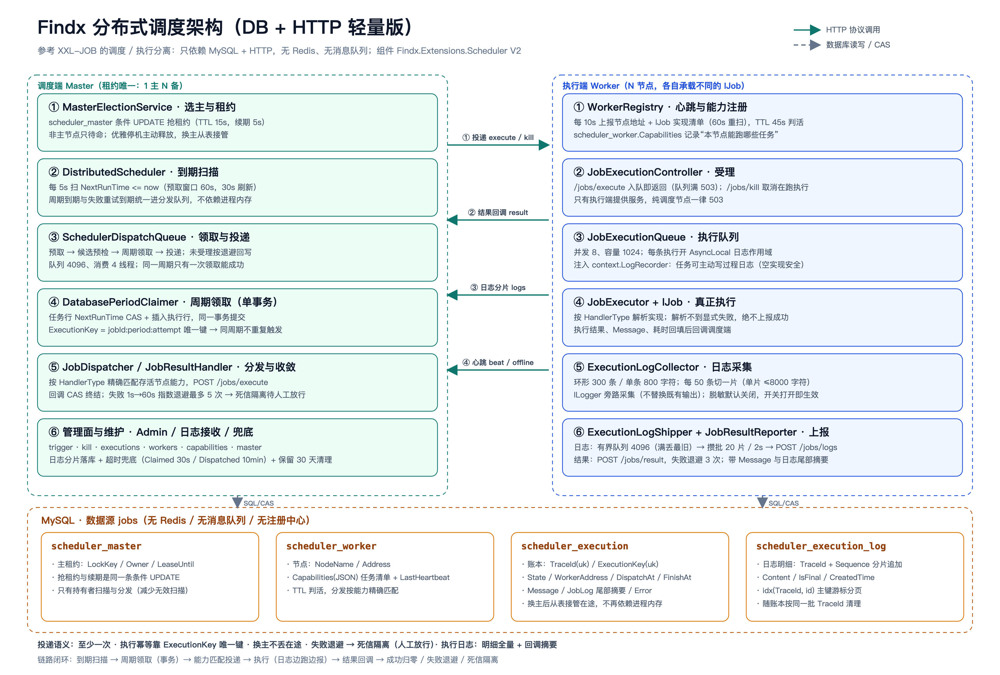
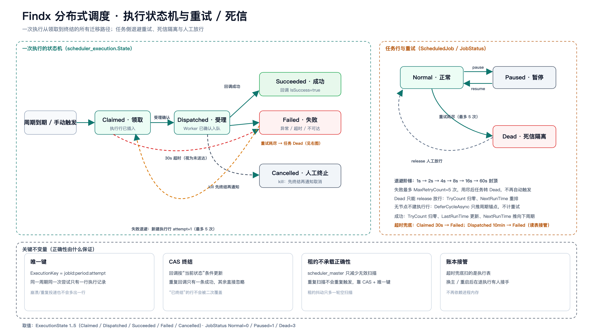

# Findx.Extensions.Scheduler

轻量级分布式任务调度组件：**只依赖数据库 + HTTP**，不引入 Redis / MQ / 注册中心。

作业定义持久化在 `scheduler_jobs` 表，Master 按 Cron 计算到期时刻并投递到具备该作业能力的 Worker，Worker 受理后异步执行并回传结果；失败按指数退避重试，超过上限**真正隔离**并等待人工放行。

作业实现仍然复用 `Findx.Jobs` 的 `IJob`，**同一份 Job 代码，内存版和分布式版通用**。


```
Findx.Extensions.Scheduler
```

目标框架 `net6.0` / `net8.0` / `net10.0`。依赖 `Findx`、`Findx.AspNetCore`、`Findx.FreeSql`（数据源 `jobs`）。

## 与内存版 Jobs 的关系

`SchedulerModule` 声明 `[DependsOnModules([typeof(JobModule)])]`，但 `Findx:Jobs:ScheduleType = Distributed` 时 `JobModule` 不注册任何调度 / 执行服务（内存版整体跳过）。

启动时做**互斥校验**：只要 `SchedulerEnabled` 或 `WorkerEnabled` 为真，就必须同时满足


```
{ "Findx:Jobs": { "Enabled": true, "ScheduleType": "Distributed" } }
```

否则直接抛 `InvalidOperationException` —— 两套循环同时运行会让同一作业被触发两次。

同时校验 `Findx:Scheduler:ClusterToken` 非空，否则 `execute` / `result` / `beat` / `kill` 这些机器间接口等于零鉴权（内网任意客户端可触发任意 `IJob`）。

## 架构总览



> 完整图文说明页（带目录、链路、协议、配置）：[scheduler-architecture.html](scheduler-architecture.html)




```mermaid
flowchart TB
    subgraph DB[(数据源 jobs)]
        T1[scheduler_master<br/>单行租约]
        T2[scheduler_worker<br/>节点心跳]
        T3[scheduler_jobs<br/>任务定义 + 周期锚点]
        T4[scheduler_execution<br/>执行账本]
        T5[scheduler_job_dead_letter<br/>死信记录]
    end

    subgraph Master[调度端]
        E[MasterElectionService<br/>租约抢占/续期]
        S[DistributedScheduler<br/>扫描循环 1s（纯内存，无 DB/HTTP）]
        B[SchedulerJobBuffer<br/>内存预取窗口 60s]
        Q[SchedulerDispatchQueue<br/>有界队列 + 分发线程]
        P[DatabasePeriodClaimer<br/>任务行 CAS + 执行行 INSERT 同事务<br/>写入前查重，键冲突降级为单条]
        D[JobDispatcher<br/>选点 + HTTP 投递]
        RH[JobResultHandler<br/>终结权 + 退避/隔离]
        SW[TimeoutSweepService<br/>独立节拍 30s<br/>Claimed / Dispatched 两趟]
    end

    subgraph Worker[执行端]
        C[JobExecutionController<br/>POST /execute]
        EQ[JobExecutionQueue<br/>有界队列 + 执行线程 + Kill]
        RP[JobResultShipper<br/>批量 + 并发上报]
    end

    E --> T1
    S --> B --> T3
    S --> Q --> P --> T3
    P --> T4
    Q --> D --> C
    C --> EQ --> RP -->|POST /results（批量）| RH
    RH --> T3
    RH --> T5
    SW --> T4
    SW --> RH
```

## 正确性由什么保证

**正确性来自数据库 CAS，不来自锁**。三重仲裁各管一件事：


| 仲裁  | 载体                                                                             | 作用                                        |
| --- | ------------------------------------------------------------------------------ | ----------------------------------------- |
| 调度权 | `scheduler_jobs.NextRunTime` 列级 CAS（`UPDATE ... WHERE id=? AND NextRunTime=?`） | 同一周期只有一个 Master 能推进锚点                     |
| 执行权 | `scheduler_execution.ExecutionKey = jobId:period:attempt` 唯一键                  | 同一周期同一次尝试只有一行执行记录                         |
| 租约  | `scheduler_master` 单行条件 UPDATE                                                 | 只减少无效扫描，**不承载正确性**；双 Master 只会多扫一轮，不会重复触发 |

**关键事务边界**：领取时在**同一事务**里先做任务行 CAS（影响 0 行 = 别人抢到，整体回滚放弃），再 `INSERT` 执行行。


* 提交前崩溃：什么都没变，下一轮继续扫描。

* 提交后立刻崩溃：留下 `Claimed` 行，由超时兜底接管，**不丢**。

因此投递语义是**至少一次**（at-least-once），不承诺恰好一次。业务侧如需强幂等，请用回传的 `TraceId` / `ExecutionKey` 自行去重。

**唯一键冲突怎么处理**：同一批领取的行如果撞上已存在的 `ExecutionKey`（并发重投、窗口重载等情况），
若直接批量 `INSERT`，一条冲突会让整批 50 条一起回滚。因此写入前先按本批 `ExecutionKey` 做一次 `IN` 查询：
命中的条目从待插入列表里剔除、对应请求按「未领取」返回，其余照常提交。
代价是每批多一次索引查询（实测 `IN(50)` p50 0.65ms，摊到每条 0.013ms），换来的是碰撞只丢一条而不是整批 50 条。

## 执行状态机


```
Claimed ──受理──▶ Dispatched ──回调──▶ Succeeded
   │                 │
   └──未确认受理超时──┴──执行超时/拒绝/不可达──▶ Failed ──▶ 退避重试 ──▶ 超限 ──▶ Dead（隔离）
                                   └─人工终止──▶ Cancelled
```


* `Claimed → Dispatched` 只能由分发确认推进（`State = Claimed` 谓词 CAS）。

* 终态由 `TryFinalizeAsync` 用 `State IN (Claimed, Dispatched)` 谓词抢占**终结权**：回调、超时兜底、人工终止三者并发时只有一方成功，其余静默放弃。

* 终态不可迁移，没有任何回退边。

## 执行记录、执行结果与执行日志

`scheduler_execution` 一次触发一行，既是执行权凭证，也是事后复盘的全部依据：

| 字段 | 内容 |
|---|---|
| `TraceId` / `ExecutionKey` / `Period` / `Attempt` | 链路号、幂等键（`jobId:period:attempt`）、周期标识、第几次尝试 |
| `State` | `Claimed → Dispatched → Succeeded / Failed / Cancelled` |
| `WorkerAddress` / `DispatchAt` / `FinishAt` / `ElapsedMs` | 在哪台机器、何时受理、何时结束、耗时 |
| `Error` | 失败原因（分发失败、执行异常、超时、人工终止各有明确文案） |
| `Message` | 执行结果消息（`JobResult.Message`，成功失败都记） |
| `JobLog` | 执行过程日志（执行端按 TraceId 采集，超长保留尾部） |

执行端有两个日志入口，互相补充：

| 入口 | 谁写 | 用途 |
|---|---|---|
| `context.LogRecorder`（`IJobLogRecorder`：`Info/Warn/Error`） | Job 主动写 | 业务语义的过程记录（"处理到第 3 批""跳过 12 条脏数据"），不依赖日志级别配置 |
| `ILogger` 输出 | Job 及其依赖的组件 | 组件注册的 `ExecutionLogProvider`（标准 `ILoggerProvider`，旁路追加、不替换 NLog/控制台）自动采集 |

`JobExecutionQueue` 每次执行前用 `ExecutionLogCollector.Begin(TraceId, JobId, sink)` 开启 `AsyncLocal` 作用域，并把作用域作为
`JobExecuteContext.LogRecorder` 注入；调度侧关键事件（开始、完成、异常、人工终止）由队列显式补充。

**日志走队列上报，不随结果回调一次性传输**（日志可能上千行，塞进回调会拖慢结果回传并放大超时风险）：

```
Job 写日志 → 作用域缓冲（环形 300 条 / 单条 800 字符）
   ├─ 每满 50 条切一片（单片 ≤ 8000 字符）→ ExecutionLogShipper 有界队列（默认 4096，满时丢最旧）
   │        └─ 后台攒批（默认 20 片 / 2s 窗口）→ POST {Master}/api/scheduler/jobs/logs → scheduler_execution_log 逐片追加
   └─ 执行结束 FlushFinal() 补最后一片（IsFinal=true）→ 账本行 JobLog 只存尾部摘要（MaxExecutionLogChars，默认 20000）

结果回调里的 Logs 是"尾部摘要"，完整过程在明细表；两者分工避免单行被日志撑大。
```

明细表 `scheduler_execution_log`（一次执行多行，按 `Sequence` 递增）：`TraceId` / `JobId` / `Sequence` / `Content` / `IsFinal`。
上报失败的处理：单地址重试 2 次后放弃并计数，**不回灌队列、不影响任务结果**——日志是旁证，不能反压执行，也不进任务重试。

限制（按设计接受）：`AsyncLocal` 随执行上下文流动，Job 内 `Task.Run` / `await` 的日志会捕获；自行 `new Thread` 或投递到外部队列后再执行的日志
不在本次上下文中，不会被采集。进程崩溃时未发送的分片丢失（已发出的分片保留）。日志只落调度端，执行端本地仍由原日志框架正常输出。

查询：`GET executions?jobId=&limit=&includeLogs=`（默认不返回日志）、`GET executions/{traceId}`（详情含 `JobLog` 尾部摘要）、
`GET executions/{traceId}/logs?afterId=&limit=`（明细分页，主键游标，适合"加载更多"）。

**脱敏**（默认关闭）：`LogMaskingEnabled=true` 时在"写入采集作用域"这一层脱敏，因此分片上报、明细表、回调摘要三处都是脱敏后的文本。
内置规则覆盖 `password/pwd/secret/token/access_key/apiKey/authorization` 键值（保留键名、抹掉值）、`Bearer xxx`、手机号、18 位身份证号；
`LogMaskPatterns` 可追加自定义正则（命中替换为 `***`，非法正则自动忽略）。

## 超时兜底（换主 / 重启后仍然有效）

兜底扫描读的是**执行账本表**，不是进程内存。它由独立的 `TimeoutSweepService` 承担（仅 Master 注册）：默认 30 秒一拍、每批 100 条、每 25 行让出 `SweepBatchDelayMs`。
这样「超时集中爆发」只会拖慢兜底自己，不会占用 `DistributedScheduler` 的扫描节拍——扫描线程因此只做内存比对与入队。

| 状态           | 条件                                     | 处理                              |
| ------------ | -------------------------------------- | ------------------------------- |
| `Claimed`    | 超过 `ClaimTimeoutSeconds`（默认 30s）       | 视为未送达，终结为 `Failed` → 退避重试       |
| `Dispatched` | 超过 `ExecutionTimeoutMinutes`（默认 30min） | 视为执行超时，终结为 `Failed` → 退避重试 / 隔离 |

## 节点任务清单（能力注册）

每个执行节点承载的 `IJob` 实现可能不同，所以心跳注册的不只是"节点"，还有**该节点能执行的任务清单**：

- 执行端每个心跳周期上报 `WorkerNodeInfo.Capabilities`：本节点扫描到的 `IJob` 实现类全名（`Type.FullName`）；
- 清单按 `CapabilityRefreshSeconds`（默认 60s）重新扫描，插件热加载 / 条件注册导致的能力变化会在下一次心跳生效，并打 Info 日志；
- 调度端把清单落库到 `scheduler_worker.Capabilities`，按心跳 TTL 判活后加载进内存快照；
- 分发按 `HandlerType` 精确匹配（缺 `HandlerType` 时才退化为按 `JobName`），避免把任务投到没部署该实现的节点；
- 执行端解析不到实现时**显式失败**（`JobExecutor` 置 `IsSuccess=false` 并带上"执行节点未注册该作业实现"），不再静默返回被当成成功上报。

诊断：`GET /api/scheduler/admin/capabilities` 返回每个任务被哪些节点承载、以及**没有任何存活节点承载的任务**（部署缺失或 `HandlerType` 配错）。

## 没有可执行节点时

节点滚动重启、扩缩容期间「某任务没人能接」不算任务失败，处理方式是：


1. 分发前预检能力（按 `HandlerType` 精确匹配节点清单）—— 无候选节点时**不建执行行**，避免每轮扫描积一条失败流水；日志会区分「集群无存活节点」与「有节点但都没注册该任务」；

2. 周期条目在延后时**同时用 CAS 把&#x20;**`NextRunTime`**&#x20;推进到下一次**并写入 `RetryAtTime`。只写退避时刻而不推进锚点，会让「本周期仍到期未领取」留在库里，等这次后移的重试分发完成后同一触发点被再领一次 —— 即重复执行；

3. 到点后的重试走 `R:` 前缀条目，`TryCount` 不变（不消耗重试预算），因此节点短暂下线不会把任务推进死信。

## 死信隔离（真正停机，不是继续跑）

达到 `MaxRetryCount` 后：


1. 写 `scheduler_job_dead_letter`（审计用，可关闭）；

2. `Status = Dead(3)`、`NextRunTime = null`、`RetryAtTime = null`、`TryCount` 保留。

扫描按 `Status == Normal` 过滤，任务从此不会再被取到 —— 这与 "写死信表 + 归零计数 + 继续调度" 的旧语义相反。

人工放行 `POST /api/scheduler/admin/jobs/release` → `Status = Normal`，按 Cron 重算 `NextRunTime`。

## 配置项（`Findx:Scheduler`）


| 键                                                    | 默认                       | 说明                              |
| ---------------------------------------------------- | ------------------------ | ------------------------------- |
| `NodeName`                                           | `MachineName`            | 节点标识，参与 `WorkerId` 推导           |
| `NodeAddress`                                        | `http://localhost:5000`  | 本节点对外地址；写进分发包供执行端回调             |
| `SchedulerEnabled`                                   | `true`                   | 是否承担调度端职责                       |
| `WorkerEnabled`                                      | `true`                   | 是否承担执行端职责                       |
| `MasterEndpoints`                                    | `[]`                     | 执行端上报 / 回调的兜底地址列表               |
| `ClusterToken`                                       | 空（启用时必填）                 | 机器间接口令牌，请求头 `X-Scheduler-Token` |
| `MasterLockKey`                                      | `findx:scheduler:master` | 租约键，多集群共库时区分                    |
| `MasterLockTtlSeconds`                               | `15`                     | 租期；按 TTL/3 续期                   |
| `WorkerHeartbeatTtlSeconds`                          | `45`                     | 心跳存活阈值                          |
| `WorkerHeartbeatIntervalSeconds`                     | `10`                     | 心跳间隔                            |
| `CapabilityRefreshSeconds`                           | `60`                     | 本地任务清单（IJob 全名）刷新间隔，随心跳上报 |
| `SchedulerScanIntervalSeconds`                       | `1`                      | 到期扫描间隔；按时间栅格对齐（扫描线程只做内存比对与入队）。扫描无 I/O，误差上限 = 一个间隔 |
| `SweepIntervalSeconds`                               | `30`                     | 超时兜底独立节拍（秒），与扫描循环互不占用 |
| `SweepBatchSize`                                     | `100`                    | 单批兜底条数（Claimed / Dispatched 各一趟） |
| `SweepBatchDelayMs`                                  | `50`                     | 批内每 25 行让出的毫秒数，避免长时间占用连接 |
| `MaxRetryCount`                                      | `5`                      | 单周期最大重试次数                       |
| `RetryBaseDelayMs` / `RetryMaxDelayMs`               | `1000` / `60000`         | 指数退避基数 / 上限                     |
| `ClaimTimeoutSeconds`                                | `30`                     | 领取后未确认受理的兜底时限                   |
| `ExecutionTimeoutMinutes`                            | `30`                     | 已受理无回调的超时；`0` 关闭；**Worker 崩溃后要等这么久才重投，建议按业务 SLA 调为 5** |
| `DeadLetterEnabled`                                  | `true`                   | 是否写死信审计记录（隔离本身总是生效）             |
| `DispatchStrategy`                                   | `RoundRobin`             | 分发策略                            |
| `DispatchQueueCapacity` ★                            | `0` → 16384              | 分发端有界队列；容量须大于单波到期任务数 |
| `DispatchWorkerCount` ★                              | `0` → CPU 核数（2~16）     | 分发线程数（领取事务 + 投递 + 退避都在这） |
| `DispatchMaxInFlight` ★                              | `0` → 分发线程 × 8        | 全局在飞请求上限：吞吐 ≈ 该值 / 单次往返耗时，组内并发投递，与线程数解耦 |
| `DispatchClaimBatchSize`                             | `50`                     | 批量领取条数：一个线程一次领取多少条共用一个事务；`1` 退化为逐条领取 |
| `DispatchHttpTimeoutSeconds`                         | `2`                      | 投递 / 回调 HTTP 超时                 |
| `ExecutionQueueCapacity` ★                           | `0` → max(2048, 线程×256) | 执行端受理队列（突发缓冲）；必须吞下单波每端任务数 |
| `ExecutionWorkerCount` ★                             | `0` → 2×CPU（4~32）       | 执行端并发线程数                       |
| `MaxExecutionLogChars`                               | `20000`                  | 结果回调携带的日志尾部摘要上限（超出保留尾部）   |
| `LogShipQueueCapacity`                               | `4096`                   | 日志上报队列容量（有界，满时丢最旧）             |
| `LogShipBatchSize`                                   | `20`                     | 单次 HTTP 上报的分片数上限                       |
| `LogShipIntervalMs`                                  | `2000`                   | 分片合并上报窗口（毫秒）                         |
| `ResultShipQueueCapacity` ★                          | `0` → 执行队列 × 2        | 结果上报队列容量（有界，满时回落逐条上报，不丢）   |
| `ResultShipBatchSize`                                | `20`                     | 结果单批上报条数；`1` 关闭批量，回落逐条回调       |
| `ResultShipIntervalMs`                               | `1000`                   | 结果合并上报窗口（毫秒）                         |
| `ResultShipConcurrency` ★                            | `0` → 线程数/4（2~8）      | 结果批量上报的并发批次数；串行时上行吞吐被往返时延锁死 |
| `LogMaskingEnabled`                                  | `false`                  | 执行日志脱敏开关（默认关闭，原样入库）           |
| `LogMaskPatterns`                                    | 空                       | 脱敏附加正则（命中替换为 `***`）                 |
| `RetentionDays`                                      | `30`                     | 执行历史保留天数（账本+日志明细，`<=0` 不清理）  |
| `RetentionSweepIntervalMinutes`                      | `1440`                   | 清理扫描间隔（分钟，最小 10）                    |
| `RetentionBatchSize`                                 | `500`                    | 单批删除条数                                     |
| `LookaheadWindowSeconds` / `LookaheadRefreshSeconds` | `60` / `30`              | 内存预取窗口                          |
| `MisfireStrategy`                                    | `FireOnceNow`            | 错过周期处理                          |
| `CatchUpWithinWindow` / `CatchUpMaxCount`            | `false` / `30`           | 是否补触发过去周期                       |

**带 ★ 的容量类参数：`0` 表示按机器能力自动推导，不用手填。** 推导规则（读时计算，不依赖 `PostConfigure`，
所以手工 `new SchedulerOptions()` 也不会拿到 0）：

```
ExecutionWorkerCount    = clamp(2 × CPU, 4, 32)              // 8 核 → 16
ExecutionQueueCapacity  = max(2048, 线程数 × 256)             // 16 线程 → 4096
ResultShipConcurrency   = clamp(线程数 / 4, 2, 8)              // 16 线程 → 4
ResultShipQueueCapacity = 执行队列 × 2                         // → 8192
DispatchWorkerCount     = clamp(CPU, 2, 16)                   // 8 核 → 8
DispatchMaxInFlight     = 分发线程 × 8                          // → 64
DispatchQueueCapacity   = 16384
```

依据来自实测：8 线程时执行端队列满 9527 次，32 线程为 0 次；在飞 64 与 128 无差异、256 反而劣化。
只有「单波 ≥ 5000 且业务耗时 ≥ 100ms」这类场景才需要显式把线程/队列再翻一倍。

## 建表

四张表：`scheduler_master`（选主租约）/ `scheduler_worker`（节点 + 任务清单）/ `scheduler_execution`（执行账本，含结果消息与日志尾部摘要）/
`scheduler_execution_log`（执行过程日志明细）。组件首次运行时按实体自动建表（`UseAutoSyncStructure`），但**唯一键与查询索引不会自动建**，
必须执行 [docs/sql/scheduler\_v2.sql](sql/scheduler_v2.sql)：


* `uk_exec_trace (TraceId)`：回调幂等定位

* `uk_exec_key (ExecutionKey)`：同周期同尝试唯一

* `idx_exec_state_dispatch (State, DispatchAt)`：超时兜底扫描

* `uk_worker_id (WorkerId)`：心跳 upsert

* `idx_log_trace (TraceId, id)`：执行过程日志按链路游标分页

补充两条与「自动建表」相关的约定：

- `scheduler_jobs` / `scheduler_execution` / `scheduler_worker` / `scheduler_execution_log` / `scheduler_job_dead_letter` 的 `id`
  在实体上是 `[Key][Column(name:"id")]`，结构同步建出来的是**普通 bigint 主键（没有 AUTO_INCREMENT）**。
  因此所有插入路径都由组件用 `IKeyGenerator<long>`（默认雪花）显式赋值，**不能依赖数据库自增**；
  也意味着 DDL 里的 `AUTO_INCREMENT` 会在启动时被结构同步改掉，这是预期行为。
- 长文本列必须在实体上声明类型：`SchedulerExecution.JobLog` 为 `mediumtext`、`SchedulerExecutionLog.Content` 为 `text`。
  不声明时 FreeSql 默认 `varchar(255)`，几百字的执行日志尾部会让结果回调直接 500（`Data too long for column`）。

## 执行历史清理

账本与日志明细都只增不减，组件内置清理任务（`ExecutionRetentionService`，只在 Master 上跑）：

- 删除条件：`State` 已终结（`Succeeded/Failed/Cancelled`）且 `FinishAt` 早于 `Now - RetentionDays`（默认 30 天）；
- **先删日志明细再删账本行**，两批用同一组 `TraceId`，不会出现孤儿日志，也不会出现"账本还在但日志被删"；
- 分批处理（`RetentionBatchSize`，默认 500），单轮最多 200 批，避免一次删爆数据库；
- 扫描间隔 `RetentionSweepIntervalMinutes`（默认 1440 分钟），启动后延迟 1 分钟再开始；
- 多节点同时清理是安全的：删除按 `TraceId` 集合，重复执行影响行数为 0；
- `RetentionDays<=0` 关闭清理（需要永久保留历史时这么配）。

## 扩展开关

所有中间件相关能力都收敛在 `Abstractions` 下，替换实现即可换协调介质（Redis/etcd/ZK），业务与调度链路代码不变：


| 接口                 | 职责                      | 当前实现                      |
| ------------------ | ----------------------- | ------------------------- |
| `IMasterLease`     | 主节点租约                   | `DatabaseMasterLease`     |
| `IWorkerDirectory` | 节点注册 / 心跳 / 存活查询        | `DatabaseWorkerDirectory` |
| `IExecutionLedger` | 执行账本读写与终结               | `DatabaseExecutionLedger` |
| `IPeriodClaimer`   | 周期 / 重试 / 手动触发的领取事务     | `DatabasePeriodClaimer`   |
| `IClusterClock`    | 集群时间（`Calibrate` 可校准偏移） | `LocalClusterClock`       |

## 管理面 API

均以 `X-Scheduler-Token` 鉴权（与机器间接口同一令牌），前缀 `POST/GET /api/scheduler/admin/`：


| 路径                                | 说明                               |
| --------------------------------- | -------------------------------- |
| `GET jobs`                        | 任务定义列表                           |
| `POST jobs/save`                  | 新增 / 修改（Cron 变化时重算下次触发）          |
| `POST jobs/remove`                | 删除                               |
| `POST jobs/pause` / `jobs/resume` | 暂停 / 恢复（Dead 状态拒绝，需走放行）          |
| `POST jobs/release`               | 死信放行                             |
| `POST jobs/trigger`               | 立即触发一次（不改周期锚点）                   |
| `GET executions?jobId=&limit=&includeLogs=` | 执行记录列表（默认不含日志）                |
| `GET executions/{traceId}/logs?afterId=&limit=` | 执行过程日志明细（主键游标分页，≤500/页）   |
| `GET executions/{traceId}`        | 执行详情（结果消息 + 执行过程日志）              |
| `POST executions/kill`            | 人工终止：先终结执行行为 `Cancelled`，再通知节点取消 |
| `GET workers`                     | 存活节点列表（含各自任务清单）                     |
| `GET capabilities`                | 任务→节点覆盖矩阵 + 无节点承载的任务清单              |
| `GET master`                      | 当前主节点                                 |

## 机器间协议


| 方法     | 路径                               | 方向                                                           |
| ------ | -------------------------------- | ------------------------------------------------------------ |
| `POST` | `/api/scheduler/jobs/execute`    | Master → Worker，投递任务（受理即 `200`）                              |
| `POST` | `/api/scheduler/jobs/result`     | Worker → Master，回传结果（含 `Message` 与日志尾部摘要）            |
| `POST` | `/api/scheduler/jobs/results`    | Worker → Master，批量回传结果（多条合并；调度端逐条幂等终结）        |
| `POST` | `/api/scheduler/jobs/logs`       | Worker → Master，执行日志分片（≤64 片/请求，需 `SchedulerEnabled`） |
| `POST` | `/api/scheduler/jobs/kill`       | Master → Worker，取消执行                                         |
| `POST` | `/api/scheduler/workers/beat`    | Worker → Master，心跳（仅 `SchedulerEnabled=true` 的节点受理，否则 `503`） |
| `POST` | `/api/scheduler/workers/offline` | Worker → Master，下线摘除                                         |

上行三条（登记 / 结果 / 日志）在代码里统一收敛为 `ISchedulerMasterChannel`：执行端只认这个接口，不认 HTTP。
这是为后续 RPC 留的缝——加一个 `GrpcSchedulerMasterChannel` 并在 `WorkerEnabled` 分支替换注册即可，其余代码零改动。

## 执行端为什么没有数据库连接

执行端的定位是「只干活的进程」：它需要的是访问调度端的能力，而不是数据权限。如果执行端也持有连接池，
一旦执行端被横向移动（任务代码本身就是业务代码），就等于把调度库的写权限扩散到了所有跑任务的机器。

现状实现（组件内可逐行核对）：

- **调度端**（`SchedulerEnabled=true`）注册数据库原语：`IMasterLease` / `IWorkerDirectory` / `IExecutionLedger` / `IPeriodClaimer` / `IExecutionLogStore` 与 `ScheduledJobStorage`。
- **执行端**（`WorkerEnabled=true`）**不注册上述任何一项**，只注册 `ISchedulerMasterChannel` + 执行队列 + 日志采集/上报。
- 节点登记、结果回报、日志分片三条上行全部走 `ISchedulerMasterChannel`，当前实现 `HttpSchedulerMasterChannel`（HTTP）；换成 gRPC / RPC 只需替换这一行注册，执行端内部代码不变。
- 调度端接口（心跳接收、结果回调、日志接收、管理面）标了 `[MasterRoleOnly]`：纯执行端调用返回 `503`，不会去解析不存在的数据库服务。
- 调度端与执行端同进程时也不再「直接写库登记自己」，而是回环到本机 `NodeAddress` 走同一套协议（未配置 `MasterEndpoints` 时自动回环）。

## 性能（实测）

测试口径：**1 调度端 + 4 执行端**、8 分发线程、领取批量 50、在飞 64、每 10 秒一波、采样 40 秒，
容量类参数全部走自动推导（8 核机器：执行端 16 线程 / 4096 队列 / 上报并发 4 / 上报队列 8192）。

### 全链路四档

| 档位 | 波内任务 | 业务耗时 | 行数 | 完成率 | 下发 lag p50 / p95 | 队列满 | 整批回滚 |
|---|---|---|---|---|---|---|---|
| 低负载 | 500 | 0ms | 2000（4 波） | **100%** | 0.071s / 0.161s | 0 | 0 |
| 中负载 | 2000 | 0ms | 9600 | 91.8% | 0.202s / 0.341s | 0 | 0 |
| 高负载 | 5000 | 0ms | 20000（4 波） | **98.3%** | 0.375s / 0.631s | 0 | 0 |
| 真实耗时 | 5000 | 50ms | 20524 | 86.9% | 0.350s / 0.640s | 720 | 0 |

完成率的缺口基本来自**采样窗尾部**：40 秒窗口在最后一波中途结束，那部分行仍是 `Dispatched`（不是失败）。
5000/0ms 档 4 波完整到达、只遗留 347 行，就是这个原因。

### 执行端容量与业务耗时的关系

固定「5000 条/波、单条 50ms」，只改执行端配置（同一台 4 执行端）：

| 执行端配置 | 队列满拒收 | 完成率 | 下发 lag p95 |
|---|---|---|---|
| 8 线程 / 1024 队列（旧默认） | 9527 | 57.2% | 17.0s |
| 16 线程 / 4096 队列 | 841 | 60.0% | 0.56s |
| 32 线程 / 8192 队列 | **0** | 64.9% | 0.59s |
| **32 线程 / 8192 + 上报并发 4** | **0** | **93.3%** | 0.59s |
| 8 线程 / 1024 + 上报并发 4 | 10779 | 78.2% | 13.9s |

两条结论：

1. **执行端吞吐 ≈ 线程数 × (1 / 单条耗时)**，是物理上限。5000 条一波会在 0.6 秒内分发完，
   单端要缓冲 1250 条，队列 1024 必然溢出 → 拒收 → 调度端记失败重试 → 反过来拖慢下发（lag 从 0.6s 抬到 17s）；
2. 队列够了只是「不反馈失败」，**结果回写才是闭环的最后一环**：串行上报时一批 20 条要 342~660ms（约 40 条/s/端），
   撑不住 500 条/s 的下发速率，大批任务停在 `Dispatched`。把上报改成 4 路并发后，完成率从 64.9% 升到 93.3%、
   受理到完成 p50 从 10.5s 降到 4.1s。

### 唯一键冲突降级的收益

| 指标（5000/10s/50ms 口径） | 直接批量 INSERT | 写入前查重 |
|---|---|---|
| 整批回滚（50 条一起废） | 814 次 | **0 次** |
| DB 语句 / 每任务 | 13.32 | **8.60** |
| 下发 lag p95 | 13.58s | **2.31s** |
| 分发队列饱和 | 665 次 | **0 次** |

查重本身的成本：每批（50 条）多一次 `ExecutionKey IN (...)` 索引查询，实测 p50 0.65ms，摊到每条 0.013ms。
「多一次查询」换来的是「不再有整批回滚」，DB 语句总量反而下降 35%。

### 故障演练

| 场景 | 结果 |
|---|---|
| `kill -9` 当前 Master | 接管 15~20s；丢 1 个 10s 周期；1800 行全部成功、零重复 |
| `kill -9` 一个 Worker | 派给它的任务连接拒绝 → 退避重投成功；重试产生的 400 行也全部成功，零重复 |
| `SIGSTOP` 冻结 Worker | HTTP 2s 超时判失败 → 重投到其它节点；零重复 |
| `docker restart` MySQL（停 10s） | 约 10s 自愈，进程不崩、`Failed 0`、不留脏状态 |

### 秒级任务（10 秒级）

压测跑的就是 10 秒周期任务：5000 个任务 × 每 10 秒 = 持续 500 次/秒。秒级频度靠 cron 的秒字段表达。

| 要素 | 现状 |
|---|---|
| cron 字段 | **6 字段**（`秒 分 时 日 月 周`）才带秒；5 字段只能是分钟级。`*/10 * * * * ?` = 每 10 秒 |
| 扫描节拍 | `SchedulerScanIntervalSeconds = 1`，按整秒栅格对齐；`:00` 到期正好落在栅格点，相位偏差为零 |
| 最小粒度 | 1 秒（受扫描节拍约束）。**扫描间隔不要调大**，否则 `*/3` 这类会跨栅格丢波 |
| 实测节奏 | 500 次/秒完成率 98.3%、下发 lag p50 0.375s / p95 0.631s、整批回滚 0 |
| 切换空窗 | 默认 `CatchUpWithinWindow=false` 只补当前一次，Master 接管 15~20s ≈ 丢 1~2 个 10 秒波 |

**真正的约束是在途量，不是周期**：

```
每秒下发量 × 单条业务耗时 ≤ 执行端总线程数
```

500/s × 50ms = 25 并发，4 端 × 16 线程 = 64，宽裕；同样是 500/s 配 200ms 业务就是 100 并发，
开始排队靠队列缓冲，lag 会抬到 0.6s 量级——这就是「50ms 档完成率落到 86.9%」的机制，不是调度能力不够。

要容忍切换丢波：打开 `CatchUpWithinWindow=true`，上限 `CatchUpMaxCount=30`（10 秒任务最多补 5 分钟）。

想做到 **1 秒一发**：当前架构在边界内可行（扫描栅格本身是 1 秒），但 5000 任务 × 1 秒 = 5000/s，
是已验证 500/s 的 10 倍，属于**未测区**，正式使用前必须按同一口径重跑一轮。

容量定位：**单波 5000、保有量 5 万**。超过该量级需重新评估容量预案（见压测报告第十五节）。

## 部署要点


1. 每个节点配置唯一 `NodeName`，`NodeAddress` 必须是其它节点可访问的地址（不是 `localhost`）。

2. 全部节点执行同一份 DDL；`Findx:Jobs:ScheduleType=Distributed`、`ClusterToken` 必须配置。

3. Master 与 Worker 可在同一进程（默认全开），也可拆开：只调度设 `WorkerEnabled=false`（该节点的 `/jobs/execute`、`/jobs/kill` 直接返回 `503`，执行队列也不点火）；只执行设 `SchedulerEnabled=false` + `MasterEndpoints`（该节点不参与选举、不接收心跳）。

4. 调度端需要数据库写权限；执行端只需要 HTTP 出站访问调度端，**执行端进程不注册任何数据库原语，因而不需要数据库连接**（见上一节）。纯执行端访问调度端接口一律 `503`。

## 已知边界（按设计接受）


* **至少一次投递**：节点受理后崩溃、回调全部失败、或超时兜底重试，都可能导致同一业务被执行多次；幂等由业务侧承担。

* **租约不保证唯一 Master**：数据库故障恢复瞬间可能出现双扫描，只会多一轮无效扫描，不会重复触发（由任务行 CAS 兜住）。

* **时钟**：默认本地时间（`LocalClusterClock`），不一致的机器时钟会提前 / 延后触发；需要更严时可调用 `Calibrate` 用数据库时间校准。

* **主备切换有 15~20s 空窗**：租约 TTL 15s + 扫描间隔 1s，实测接管 15~20s；空窗内到期的触发**不会补**
  （默认 `MisfireStrategy=FireOnceNow` 且 `CatchUpWithinWindow=false`）。不能接受漏一次的任务，把 `MasterLockTtlSeconds` 降到 5~8s，或对该任务开启补触发。

* **容量目标是「单波 5000 / 保有量 5 万」**：实测 5000 条/波下发 lag p95 0.63s，完成后端到端无积压。
  超过这个量级需重新评估（见压测报告第十五节的多主分片预案）。

* **单 Master 调度，不是多主分片**：当前是一主一备，吞吐上限由单进程的扫描 + 领取 + 投递决定。
  这是有意的取舍——分片只扩调度端，扩不了共享的 MySQL。

* **Kill 是协作式的**：只对正在本节点执行且响应取消的 `IJob` 有效；执行行已在调度端终结为 `Cancelled`，不会被后续回调翻回重试。